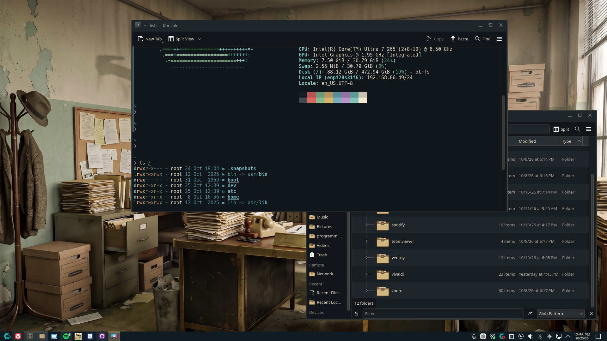

# The Department of Questionable Decisions

### Your questionable decision has been approved.

**The Department of Questionable Decisions** is a tongue-in-cheek, office-bureaucracy-inspired global theme for **KDE Plasma 6**. Think departmental paperwork, manila folders, brass accents, subdued office colors, and a desktop that looks like it has survived several unnecessary committee meetings.

Built to be distinctive **and** practical enough for everyday work.

## Screenshots



## Features

- **Plasma 6 global theme** with coordinated application color scheme and panel styling.
- **Custom Aurorae window decorations** with understated brass details.
- **Manila-inspired folders**, a departmental launcher motif, and a custom filing-cabinet icon for Dolphin.
- **Targeted icon overrides** with Breeze inheritance, so unrelated settings and applications retain recognizable icons.
- **Four themed wallpapers:** Main Office, Archives Room, Contingencies Lab, and After Hours.
- **Konsole color scheme and profile**, QML startup splash, and lock-screen wallpaper that retains KDE authentication.
- **User-level install and uninstall scripts**, with no `sudo` needed.

## Requirements

- KDE **Plasma 6** on Linux; developed through testing on **CachyOS / Arch Linux**.
- A running Plasma session for automatic wallpaper application.
- Normal KDE configuration tools such as `kwriteconfig6`; wallpaper automation uses a Qt D-Bus command when available.

Other Plasma 6 distributions may work, but compatibility has not been exhaustively verified.

## Installation

1. Download the **v1.0 release archive** from this repository's Releases page.
2. Extract the archive.
3. In a terminal, change into the extracted theme folder and run:

```bash
chmod +x install.sh uninstall.sh
./install.sh
```

**Run as your regular user, not with `sudo`.** The installer copies assets beneath `~/.local/share/`, selects KDE appearance preferences, and attempts to apply the **Main Office** wallpaper immediately.

The installer does **not** change your desktop/window layout, widgets, pinned applications, SDDM login screen, or passwords.

If KDE does not show an updated decoration or icon immediately, check **System Settings → Colors & Themes** and reselect the relevant theme component. A sign-out/sign-in may be necessary for some elements.

## Wallpaper collection

The four scenes have different flavors of departmental dysfunction:

| Wallpaper | Description |
| --- | --- |
| **Main Office** | The default departmental workspace. |
| **Archives Room** | The paperwork has been here longer than anyone remembers. |
| **Contingencies Lab** | Planning for outcomes nobody requested. |
| **After Hours** | A darker, noir-inspired take on the office. |

The default wallpaper is applied during installation where supported. Alternate wallpapers are installed for manual selection through **Right-click desktop → Configure Desktop and Wallpaper → Add Image**. Wallpaper selection may vary by Plasma version; consult the installer's printed paths for the included images.

## Konsole, splash, and lock screen

- **Konsole:** A matching profile is installed and selected for **new** windows. Existing tabs may keep their prior profile.
- **Splash:** The theme includes a Plasma 6 QML startup splash and its preview thumbnail. Choose or preview it under **System Settings → Colors & Themes → Splash Screen**.
- **Lock screen:** Press **Meta+L** to test the themed background. KDE retains its own secure unlock/password interface.

## Uninstall

From the extracted theme directory:

```bash
./uninstall.sh
```

The uninstaller removes named Department-owned theme components and switches applicable selections toward Breeze. It deliberately avoids modifying your panel layout or pinned applications. **It is not a perfect undo of all prior settings**; some wallpapers and configuration backups may remain for safety.

## Important notes

- This theme styles several coordinated **KDE Plasma components**; it does not replace every Qt, GTK, or third-party application's interior styling.
- Some KDE icon and decoration changes require reopening an application or reapplying the style.
- The installation is per-user. It does not require changes to system-wide SDDM or PAM configuration.

## License

The theme is licensed under [GPL-3.0-or-later](../LICENSE).

## Version

**1.0** — Completed release, including installer/uninstaller, wallpaper set, targeted icons, Konsole integration, splash assets, and lock-screen background.

---

*Departmental directive: All aesthetic decisions must be filed in triplicate.*
